當 AI 股單月急挫，你買入的是「回調」還是「崩盤」？

過去一個月，費城半導體指數從高點回落超過兩成，標普 500 科技板塊錄得一年多來最大的單月跌幅。Amazon 與 Alphabet 每年數千億美元的 AI 資本支出開始受到華爾街質疑，Intel 因財測不如預期單日大跌近三成，Nvidia 與 CoreWeave 也接連出現賣壓。

看著一整片下跌的 K 線，大家都在問同一個問題：這是牛市裡的正常回調，還是市場已經轉入崩盤模式？

如果你試過用 200 日移動平均線或單日跌幅來切換倉位，大概已經知道結果：盤整期一下跌破、一下站回，來回幾次，成本就吃掉不少。問題不在你看錯了哪條線。翻開過去十年的 K 線圖，沒有哪一天寫著「今日由牛轉熊」。市場換了狀態，不會通知任何人。

1978 年，數學家 Jim Simons 離開學術界，創立文藝復興科技（Renaissance Technologies）的前身時，面對的也是這個問題。他請來的第一位重要人物，沒有任何華爾街背景。Leonard Baum 是數學家，之前在普林斯頓的國防分析研究所工作，那裡替美國國安局破解密碼。

為甚麼找一個破解密碼的人來做交易？

因為兩份工作的難處相同：真實狀態看不見，只看得見帶雜訊的訊號。Baum 參與發展的隱馬可夫模型（Hidden Markov Model, HMM），處理的就是這件事，從訊號倒推背後的狀態。放到市場上，看得見的是每天的價格，看不見的是市場正處於牛市、盤整還是崩盤。

Baum 的模型後來由另一位數學家 James Ax 擴充，成為 1988 年 Medallion Fund 的起點。這檔基金在 1988 到 2018 年間，費前平均年化回報約 66%。文藝復興的模型從未公開，我們無法知道今天的 Medallion 還用多少這類方法，但這個思路沒有過時：Two Sigma 在 2021 年還發表過用高斯混合模型劃分市場狀態的研究，那是 HMM 的近親。

這套模型聽起來要滿紙矩陣，其實只有三樣東西：三座島、一張洋流表，和每天漂到岸邊的漂流瓶。看懂它們，我們就能回到開頭那個問題，算一算今天的市場究竟在哪裡。

一、三座島與一張洋流表

想像海上有三座島：陽光普照的「晴空島」（State 0：低波動牛市）、陰雲密布的「迷霧島」（State 1：高波動輪動期）、狂風暴雨的「雷暴島」（State 2：系統性恐慌）。

一艘船在這片海域漂流。它明天會停在哪座島，模型只看兩件事：今天停在哪座島，以及碼頭上那張洋流表（數學上稱為狀態轉移矩陣，Transition Matrix）：

- 今早停在晴空島：明天有 85% 的機會留下，12% 被沖去迷霧島，3% 直接被沖進雷暴島。
- 今早停在迷霧島：明天有 70% 的機會留下，20% 惡化到雷暴島，10% 回到晴空島。
- 今早停在雷暴島：明天有 80% 的機會留下，15% 回到迷霧島，5% 直接回到晴空島。

這些是為了方便講解而設的教學數字，不是估計結果。

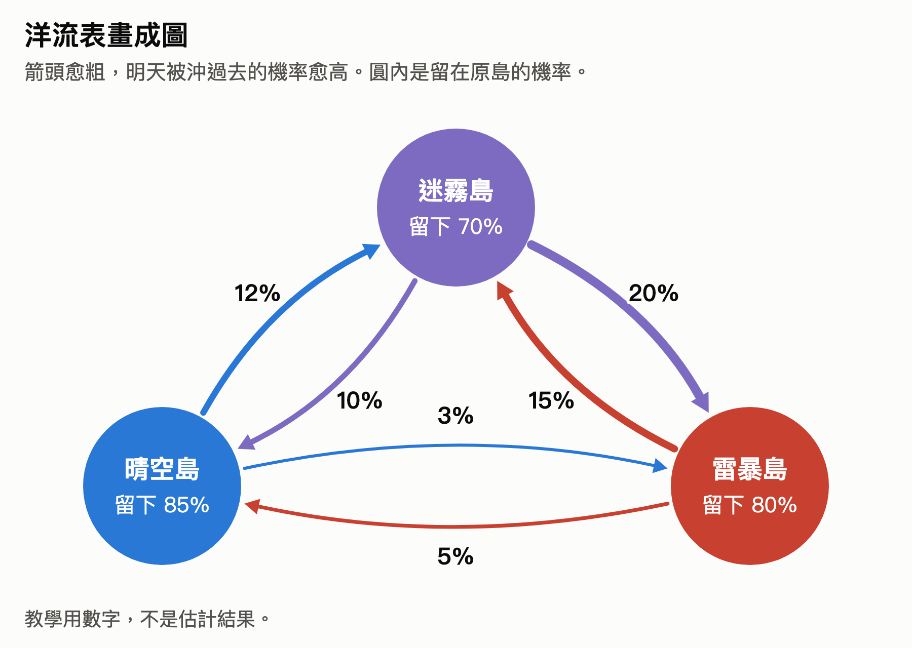

這張表藏著一個違反直覺的假設。每次科技股大跌，總有人說：「AI 股已經漲了三倍，一定見頂了。」馬可夫模型卻完全不看這些（無記憶性，Markov Property）：牛市連漲 30 天還是 300 天，它都不管，只看船今天停在哪裡。只要還在晴空島，按這張表，明天留在牛市的機率就是 85%。這是模型的簡化，不是市場的定律，但它會逼你先問今天的狀態，而不是先數漲了多久。

你可能會問：股市不是隨機漫步嗎？憑甚麼會有這種慣性？

股價的方向確實接近隨機，波動的大小卻不是。1963 年，數學家 Benoit Mandelbrot 統計市場數據時發現，大波動後面常跟著大波動，小波動後面常跟著小波動（波動率聚集，Volatility Clustering）。

那麼，波動為甚麼會黏在一起？有一部分原因，來自機構自己的風控規則。Markus Brunnermeier 與 Lasse Pedersen 在 2009 年的論文裡描述了其中一個機制：靠保證金融資的交易者，在波動上升時要多付保證金，只能賣出資產；賣出又推高波動，形成流動性螺旋。不少機構用風險價值（VaR）限制部位，作用方向相同：波動低時可以多放槓桿，波動高時要一起減倉。期權做市商的避險，有時也會順著跌勢賣出。減倉需要時間，所以風暴不會一天結束。

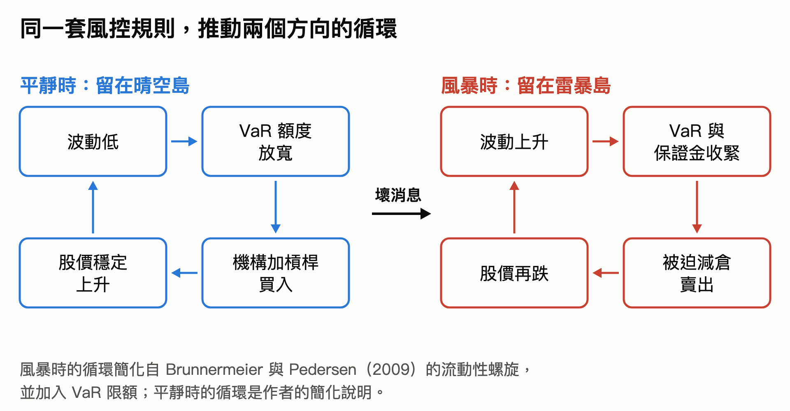

每座島都有慣性，那麼把時間拉長到幾千個交易日，船會在哪裡待得最久？只要洋流表不變，天數比例會趨向一組固定的數字（平穩分佈，Stationary Distribution）。按上面這張教學用的表計算，約是晴空島 33%、迷霧島 31%、雷暴島 36%。真實市場要從歷史資料估計：用第五節的 Prompt 和 2015 年以來的 SPY 資料，約是 36%、35%、29%，而每天留在原島的機率約 98%，比教學表高得多。換句話說，船不常換島，一旦換了，平均要待上兩至四個月。

到這裡都有一個前提：你知道船在哪裡。實際上，你不知道。

二、海灘上的漂流瓶：同一顆焦石，為甚麼意思不同

海面上有濃霧，站在岸邊的你看不見船（隱藏狀態，Hidden States）。你唯一收得到的，是船長寄來的東西：他每天早上在停靠的海灘撿一樣東西，塞進瓶子丟進海裡，傍晚漂到你腳下（每日觀測數據，Observations）。

海灘上有三種東西：代表穩健上漲的金色貝殼、代表劇烈震盪的灰色浮木、代表單日大跌的黑色焦石。

麻煩在於，每座島的海灘上三種都有，只是比例不同。黑色焦石在雷暴島最多，但晴空島也撿得到。所以收到一顆焦石，你不知道這是崩盤的訊號，還是牛市裡的雜訊。每次大跌時大家爭論的，就是這件事。

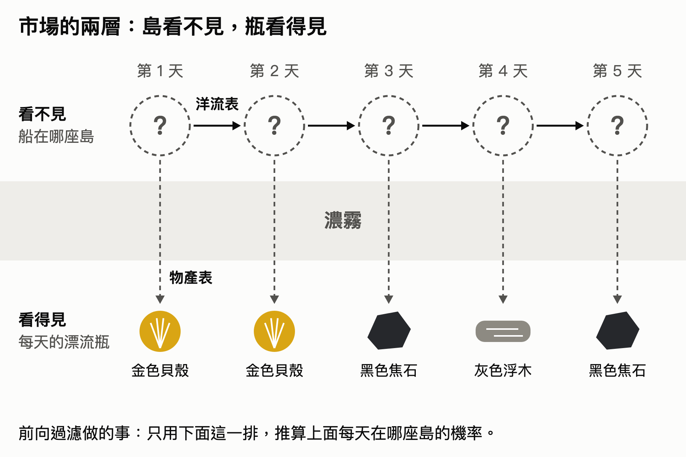

要分辨這兩種可能，需要兩張表。第一張你已經看過，第二張是每座海灘的物產比例。

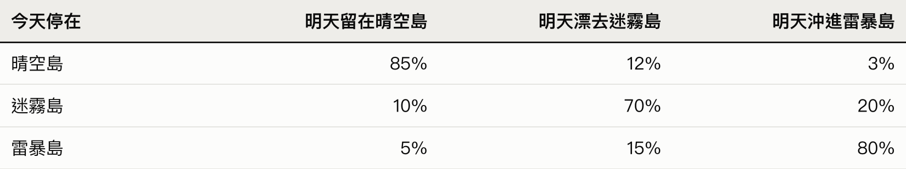

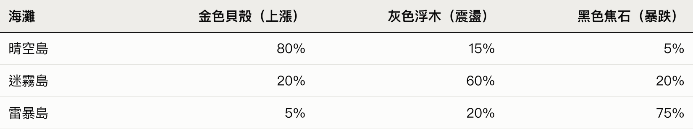

從表二可以看到，就算船穩穩停在晴空島，仍有 5% 的機會撿到黑色焦石，就像牛市裡偶爾出現單日跌 3%。

現在來做一次測試。假設前兩天收到的都是金色貝殼，我們相當肯定船在晴空島（為了好算，當作 100%）。接下來三天，瓶子裡依序是黑色焦石、灰色浮木、黑色焦石。兩顆一模一樣的焦石，模型會怎樣看？

它每天只做一件事：昨天的位置 × 洋流表 × 今天這件東西在各島出現的機率，再換算成總和 100% 的機率。這個逐日推算的方法叫前向過濾演算法（Forward Filtering）。

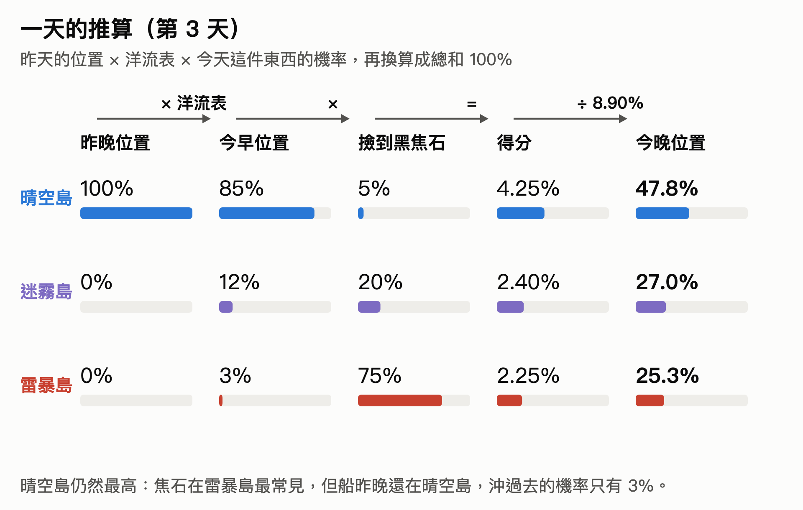

第 3 天傍晚：第一顆黑色焦石（大盤跌 3%）

這顆焦石有兩種可能：船已經被沖進雷暴島，或者船還在晴空島，只是撿到那 5%。哪一種機率較高？

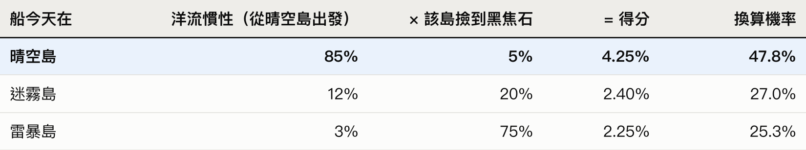

（三個得分加總是 8.90%，各自除以 8.90% 就得到機率。）

答案可能出乎意料：晴空島只從 100% 掉到 47.8%，仍然最高，差不多是雷暴島的兩倍。焦石確實在雷暴島最常見，但船昨晚還在晴空島，一天之內被沖過去的機率只有 3%。單看第一根長黑 K，還不足以判定崩盤，只算進入警戒。

第 4 天傍晚：一塊灰色浮木（高位震盪，沒有反彈）

如果第 3 天只是雜訊，第 4 天有約七成機會收到金色貝殼。來的卻是灰色浮木：沒有再跌，也沒有反彈。這一天看起來沒甚麼大不了，模型卻在這天改變了判斷。

先用洋流表把昨天的位置往前推一天：今早在晴空島的機率是 44.6%、迷霧島 28.4%、雷暴島 27.0%。再乘上各島撿到灰色浮木的機率：

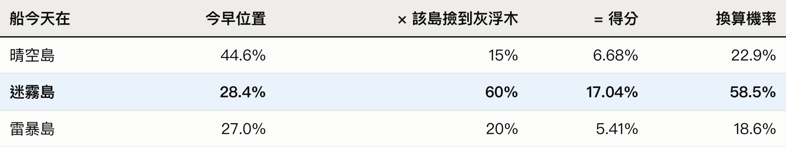

迷霧島最常出現灰色浮木（60%），機率升到 58.5%，第一次超過晴空島；晴空島跌到 22.9%。沒有大跌的一天，反而是判斷第一次翻轉的一天：船最可能已經離開低波動牛市，到了迷霧島。

第 5 天傍晚：第二顆黑色焦石（再跌破底）

第二顆焦石來了。它和第 3 天那顆一模一樣，但船已經換了位置：有近六成機率在迷霧島。洋流表上，從迷霧島沖進雷暴島的機率有 20%，從晴空島只有 3%。

先推進一天：今早在晴空島 26.3%、迷霧島 46.5%、雷暴島 27.2%。再乘上各島撿到黑色焦石的機率：

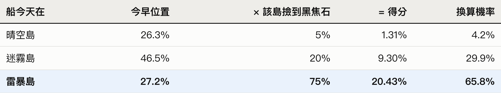

晴空島只剩 4.2%，雷暴島升到 65.8%。第 3 天同樣一顆焦石，只把雷暴島推到 25.3%。差別來自它落下時，船最可能在哪座島。這也是第一顆焦石可以先觀察，第二顆卻要認真對待的原因。

機率走勢一覽

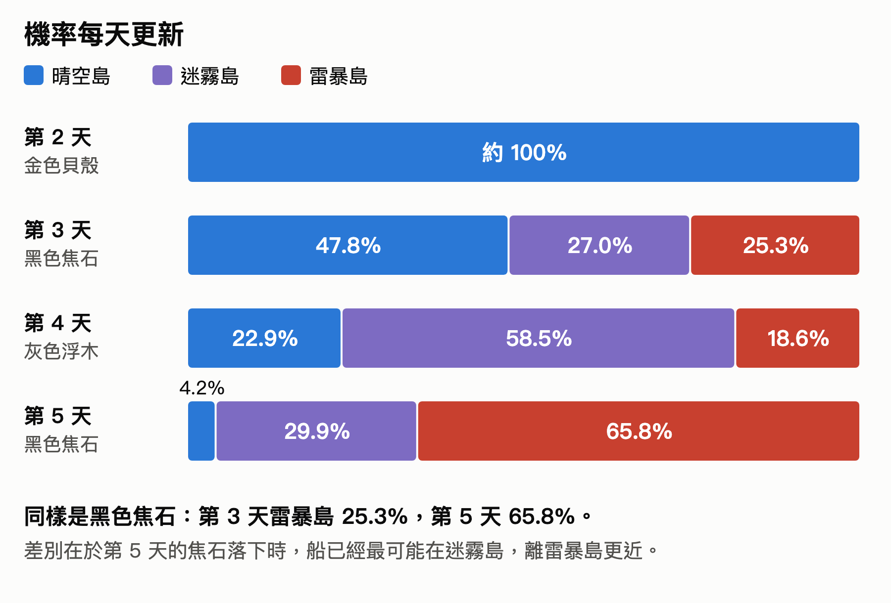

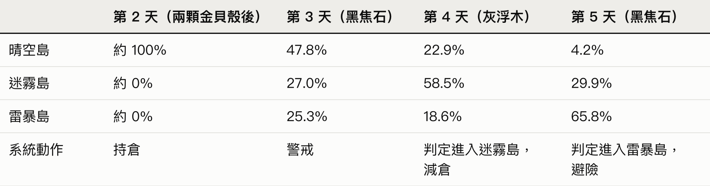

這類系統不會只憑單日的一根長黑 K 下判斷，它看的是這根 K 線出現時，市場已經在哪個狀態。

不過，模型只會和餵給它的瓶子一樣好。上面的例子裡，系統要等到第 5 天才判定進入雷暴島，那時下跌已經持續了三天。有沒有哪一種瓶子，能更快透露船的位置？

三、VIX：比單日漲跌更靈敏的漂流瓶

有。機構還會看期權市場的價格，其中最常見的是 VIX 恐慌指數（Cboe Volatility Index）和它的期限結構。

VIX 可以當成海上的颱風保險費。持有大量科技股的機構一天內賣不完股票，可以買標普 500 的賣權（Put Option）當下跌保險。買的人愈多，期權愈貴，隱含波動率（Implied Volatility）愈高。交易所把未來約 30 天的標普 500 期權價格加權，換算成市場預期的年化波動率，就是 VIX。把 VIX 除以 16，大約就是市場預期每天的平均漲跌幅百分比。

單看 VIX 還不夠。VIX3M 是同一種計算，期限換成約 3 個月，兩者一比，就看得出市場在怕眼前還是怕遠期。平常 3 個月的保費比 1 個月貴（VIX / VIX3M < 1，稱為正價差，Contango）。恐慌時，大家最擔心眼前，1 個月的保費會漲過 3 個月（VIX / VIX3M > 1，稱為逆價差或期限結構倒掛，Backwardation）。

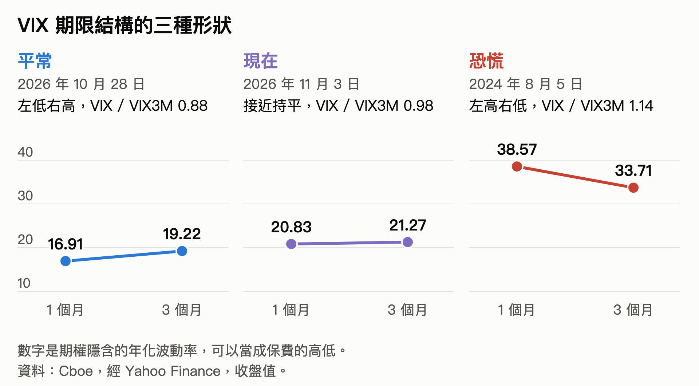

現在瓶子夠了。把報酬率、20 日實現波動率、VIX 期限結構和高收益債信用利差放在一起看，就可以替三座島定出能被資料檢驗的座標。以下門檻是我的判斷，不是市場的統一標準：

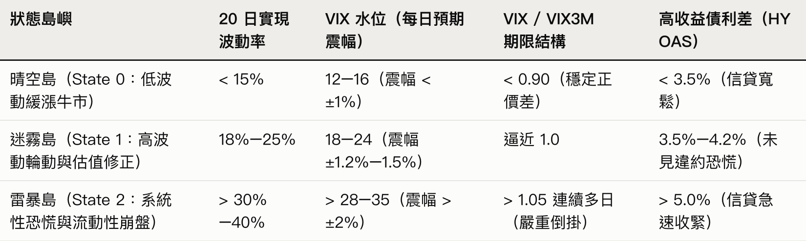

四、2026 年 11 月初，我們在哪座島上？

有了這張座標表，終於可以量一量今天的市場：經過 10 月 AI 與半導體股的急跌，市場進入系統性熊市了嗎？以下數據截至 11 月 3 日收盤，以美元計。

先看跌幅，同一場下跌，距離已經差很遠。標普 500（SPY）收在 754.35，距離 10 月 6 日的高點（779.09）只回撤 3.18%，20 日年化實現波動率 11.2%。那斯達克 100（QQQ）收在 685.28，自高點回撤 9.79%，20 日實現波動率升到 22.66%。半導體 ETF（SOXX）則回撤 21.12%，是 SPY 的六倍多。

再看市場的保險費和信貸：期權市場開始緊張，信貸市場卻還沒有。VIX 從 10 月中旬的 15 左右，升到 11 月 2 日的 21.15，11 月 3 日收在 20.83。VIX / VIX3M 約 0.98，短天期的 VIX9D / VIX 在 11 月 2 日到過 1.06，正價差快要消失。美國高收益債利差（HY OAS）升到約 3.4%（最新公布的 11 月 2 日為 3.43%），離 5.0% 的系統性危機門檻還很遠。

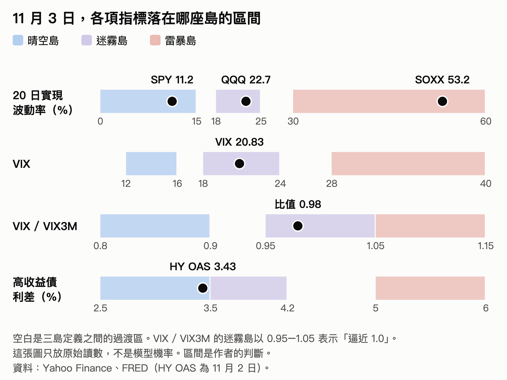

圖上的訊號並不一致：SPY 的波動率還在晴空島，VIX 已在迷霧島，SOXX 的波動率到了雷暴島。模型會怎樣綜合它們？

我把數據放進模型：3 狀態 Gaussian HMM，特徵是報酬率、20 日實現波動率、VIX 水位和 VIX / VIX3M，用 2015 年以來的資料訓練，再以前向過濾算出每天的機率。高收益債利差沒有放進模型，我另外看。三座島是模型按波動高低，替每隻標的各自分出來的，所以 SOXX 的雷暴島和 SPY 的雷暴島不是同一個尺度。

11 月 3 日的讀數，有一個地方和直覺相反：跌得最少的 SPY，並不在晴空島。

- 標普 500（SPY）：迷霧島 99.7%，雷暴島 0.3%。它的實現波動率只有 11.2%，落在第三節的晴空島區間；模型把它放在迷霧島，主要因為 VIX 水位和期限結構。這也不是 10 月底才有的變化：在這組設定下，SPY 自 4 月中旬起就一直在迷霧島，10 月 6 日創高點時也是。
- 那斯達克 100（QQQ）：迷霧島 99.3%，雷暴島 0.7%。10 月 30 日，雷暴島機率升到 5.8%，之後回落。
- 半導體與 AI 硬體（SOXX）：雷暴島約 100%。10 月 29 日，它還有 99.4% 在迷霧島；10 月 30 日單日大跌超過 8% 之後，雷暴島機率跳到 97.2%，11 月 3 日反彈至 465.00 也沒有改變讀數。前面的 21.12% 是從 10 月 5 日的高點算起，距 6 月的歷史高點約 29%；20 日年化實現波動率 53.24%。

20.83 的 VIX 與約 3.4% 的信用利差顯示，宏觀流動性沒有斷裂。我的判斷是，資金主要是從資本支出受質疑的 AI 巨頭撤出，轉往其他板塊，而不是全面逃向現金。

但這些機率不要看得太精確。同一份資料，換一組特徵，答案就可能不同：把 VIX 水位和期限結構換成 VIX 的 5 日變化率，SPY 會變成約 96% 到 100% 在晴空島。換一組隨機初始值也會不同：SOXX 的雷暴島機率，在這組特徵下由 62% 到 100% 都有。我試過的設定裡，一直成立的只有兩點：SPY 沒有進入雷暴島，SOXX 在雷暴島的機率高於迷霧島。

那麼，開頭的問題可以回答了，不過答案要分成兩半。我的判斷是：對大盤，這更像一次修正，還不是崩盤；對半導體，這已經是一場風暴。

現在不像 2008 年或 2020 年那樣全市場一起下沉，所以我不認為需要把所有股票清倉。但 AI 與半導體這類高 Beta 板塊，模型和 53.24% 的實現波動率都把它放在雷暴島，風險回報明顯變差。

這也決定了我的做法。在這種狀態下，用槓桿或短期買權（Call Option）抄底半導體，很容易被雙向震盪洗出場。我自己會看兩條規則。這是我的個人紀律，不是給讀者的買賣建議：

1. 重新加倉的條件（綠燈）：VIX 回到 18.5 以下、VIX / VIX3M 回到 0.92 以下，而且 SOXX 的 20 日波動率從 53% 降到 28% 以下（連續收到金色貝殼，雷暴島機率降回 20% 內）。
2. 全面減倉的條件（紅燈）：VIX 突破 28、VIX / VIX3M 連續三日高於 1.05，同時 HY OAS 突破 4.5% 並朝 5.0% 走。這代表局部風暴可能已經傳染成系統性流動性危機。

五、自己更新島嶼機率

這兩條規則會不會觸發，要看之後每天的讀數。今天的機率不等於下週的機率，你可以用以下兩種方式自己更新。

不寫程式的話，可以把這幾個免費數據頁加入書籤：

- 到 Cboe 的 VIX 期限結構頁面或 VolChart，每天看一眼曲線是否仍然左低右高（正價差）。曲線嚴重倒掛，而且 VIX 突破 25–28，就是雷暴島的警報。
- 到聖路易斯聯邦準備銀行（FRED）查看美國高收益債利差（ICE BofA US High Yield OAS，代碼 BAMLH0A0HYM2），或在 TradingView 看 FRED:BAMLH0A0HYM2。我的判斷是，這條曲線還低於 3.5%–3.8% 時，股市下跌較可能只是估值修正，還沒有演變成系統性信貸危機。
- 到 Portfolio Visualizer 的戰術資產配置模組（Tactical Asset Allocation）與 TradingView 的 Regime 社群指標庫，看不同波動率狀態下的資產切換回測。

想自己算每天的三島機率，可以把下面這段 Prompt 貼給能執行程式碼的 ChatGPT、Claude 或 Cursor，它會用 Python 的 hmmlearn 套件跑出結果。結果會隨資料區間、特徵和隨機初始值而變，請當成參考：

你現在是一位資深量化研究員。請用 Python（使用 yfinance、hmmlearn、pandas、numpy、matplotlib）針對美股大盤或科技與 AI 板塊（以 SPY、QQQ 或 SOXX 為標的，並加入 ^VIX、^VIX3M）建立一個 3 狀態的高斯隱馬可夫模型（3-State Gaussian HMM）進行市場狀態偵測與回測。請嚴格遵守以下五項實戰規範：

1. 下載 2015 年至今的日線數據，計算四個每日觀測特徵（漂流瓶）：日對數收益率（Log Return）、20 日滾動實現波動率（20D Realized Volatility）、VIX 水位，以及 VIX / VIX3M 比值，並在訓練前進行標準化。
2. 用 random_state 0 到 9 各訓練一次 GaussianHMM(n_components=3, covariance_type="full", n_iter=1000)，取對數似然最高的模型，並印出各次結果的差異。由於模型預設的狀態編號是隨機的，請根據各狀態的「平均波動率由低到高」強制重新排序並命名為：State 0: 晴空島（低波牛市）、State 1: 迷霧島（高波輪動/盤整）、State 2: 雷暴島（恐慌崩盤熊市），並印出 3x3 的狀態轉移矩陣（洋流航海表）與長期平穩分佈。
3. 嚴禁前視偏差（No Look-Ahead Bias）：在計算歷史回測訊號與當下狀態機率時，絕對不可直接對全樣本調用 model.predict() 或全樣本 predict_proba()，必須撰寫一個僅使用前向演算法（Forward Filtering）的逐步遞推函數，確保第 t 天的狀態機率 P(S_t | O_{1:t}) 只使用截至第 t 天收盤為止的數據。回測時，模型參數與標準化所用的平均數和標準差，也只能用第 t 天之前的數據估計（例如每年滾動重新訓練一次）。
4. 設計一個將訊號延遲一天執行（shift(1)）的回測策略：當「雷暴島」的前向過濾機率低於 40% 時持有 100% 標的，超過 40% 時於隔日切換為現金或 TLT，繪製淨值曲線並對比最大回撤與夏普比率。
5. 在最後明確印出最新一個交易日收盤後，市場處於「晴空島、迷霧島、雷暴島」的各自機率百分比，以及根據轉移矩陣推算明日（t+1）轉移至各島的預測機率。

下跌的時候，我們很容易一看到長黑 K 就問泡沫破了沒，隔天反彈又問調整結束了沒。這兩個問題，都把當天的漂流瓶當成了島。

Simons 當年找 Baum 要解的，也是同一道題：狀態看不見，只能靠看得見的訊號一天一天推算。這種做法比較安靜：用歷史資料估計洋流表，每天收盤後把新的漂流瓶放進算式，更新一次機率。機率明天還會變，所以這件事明天要再做一次。

本文為研究與教學用途，不構成投資建議。文中的門檻與規則是作者個人的判斷。
