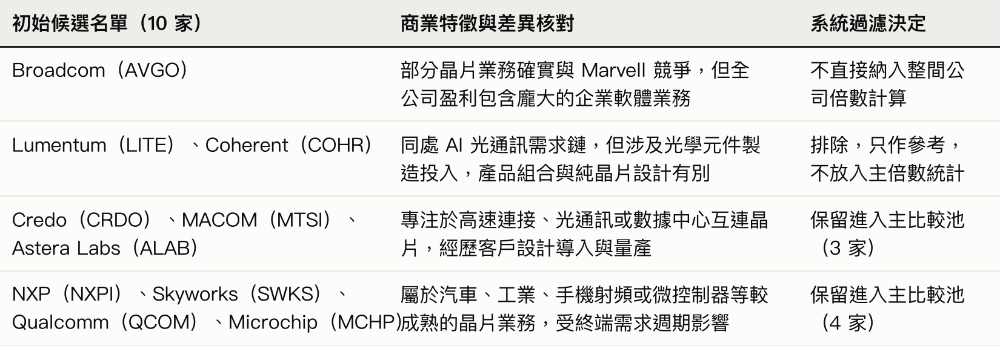
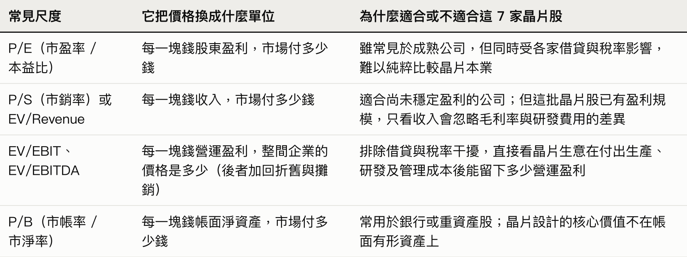
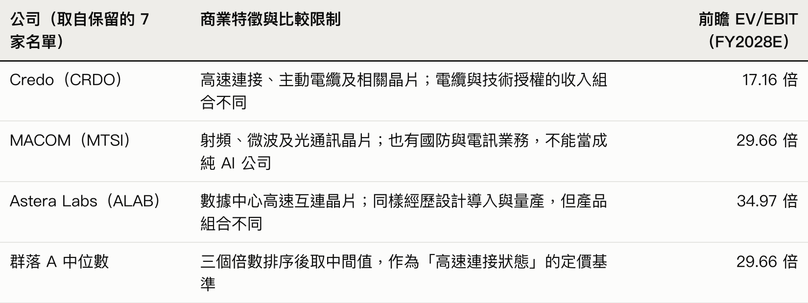
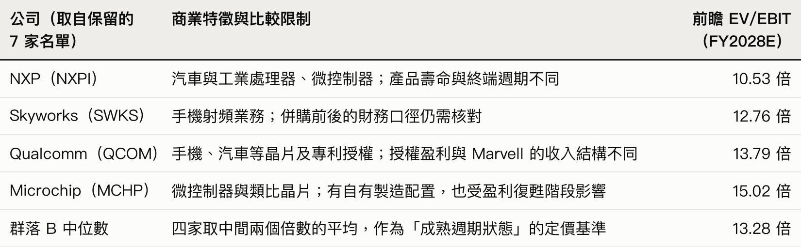
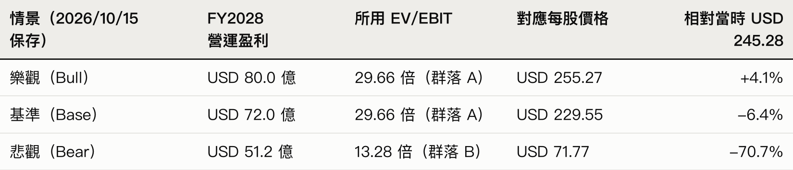

90s.PM.Investing AI 股票分析流程 102：坐標

2026 年 11 月 2 日，晶片大廠 Marvell（MRVL）宣布以全股票方式收購光通訊公司 Lumentum（LITE），進一步布局 AI 數據中心的連接需求。

這很容易寫成一個漂亮的故事：AI 需要更多算力，算力需要更快的資料傳輸，Marvell 的晶片加上 Lumentum 的光學產品，正好站在需求交會的地方。如果你打開 ChatGPT 的聊天視窗，問它「Marvell 為什麼受惠於 AI」，它十秒鐘就能交出一份結構完整的報告：產業趨勢、技術優勢、雲端大客戶、增長機會，一項不少。

但在公告當日，Marvell 股價下跌約 12.7%。

這正是絕大多數人用 AI 做股票研究時遇到的困境：你每次打開聊天視窗問一隻股票，AI 只會順著你的問題整理公司有什麼優點、為什麼有前景；但視窗一關，它就失憶了。你既不知道在按下買入之前，當時的股價已經為這些優點付了多少錢；等到下個月股價大跌或分析師改口，你也早就忘記自己當初根據什麼條件作判斷。

跟 AI 聊天，不叫研究系統。

事實上，就在 Marvell 宣布收購暴跌的兩週前（2026 年 10 月 15 日），我們自己的系統就已經為它保存了一份「坐標」檔案。當時系統算出來的結論：

就算把公司最樂觀的營收目標全部打滿，股價距離天花板也只剩 4.1% 的空間。相反，悲觀情景在股價下方約 70%。

這個系列的目標，就是要帶你脫離一次性的聊天問答，親手建立這套能幫你算清「市場坐標」、每個星期自動追蹤股價位置的 AI 股票研究系統。

一、為什麼不直接把現成系統給你抄，而是教你組裝自己的「機體」？

聽到我們已經有一套正在運作的 AI 系統，你可能會問：那你直接把現有的程式碼公開，讓我一鍵複製過去，不是最快嗎？

因為沒有親手踩過坑，拿到別人的程式碼也只是一具空殼。

圖靈獎得主 Peter Naur 在〈Programming as Theory Building〉裡記錄過一個真實案例：A 團隊開發了一套結構嚴謹的編譯器，之後把完整原始碼與詳細文件交給 B 團隊接手維護。結果 B 團隊每次新增功能，都看不出原本的結構設計，只能在外層硬加補丁，很快就把系統改壞了；而同樣的問題交回給 A 團隊，只需要順著原有結構改幾行就能解決。

系統真正的核心不是硬碟裡的代碼，而是建立者腦中對問題的理解（Theory）：為什麼要分開報價日期與估值快照？為什麼排除同業必須寫明商業理由？沒有這層理解，三個月後股價暴跌，你拿到現成代碼也一樣不知道該怎麼改。

好系統不是第一天設計好讓你抄的，而是先讓一個最簡單的骨架跑起來，在實戰除錯中逐步長出來的 - Fred Brooks 〈No Silver Bullet〉

所以，這個系列不是給你一隻別人砌好的塑膠模型，而是教你親手組裝一台陪伴你征戰市場的「鋼彈」。

要養出這台機體，不能只靠一個關掉就失憶的聊天視窗，也不能靠一份每次直接塗改舊數字的 Word 檔。我們直接用工程師現成的 GitHub 作為基地，因為它天生具備四樣東西：

1. 不可塗改的紀錄簿：保留每次修改歷史，不讓你拿著新股價忘記舊判斷。
2. 先審查後入庫的閘門：透過 Pull Request 機制，AI 改了哪幾行字，你點頭確認才生效。
3. 掛載武器的裝備架：除了放 Markdown 文字報告，日後還能直接掛上抓財報腳本與回測工具，掛上光束軍刀與步槍。
4. 自動運轉的燃料：內建的排程功能（GitHub Actions），日後可定時喚醒系統跑每週覆核。

把負責思考與執行的 Claude Code / Codex / Grok Bot 接上 GitHub，你的第一代研究機體就齊件了。

但在你把文章最後那段指令貼給 AI 之前，你這位駕駛員必須先看懂機體的判斷邏輯。我們現在就打開系統在 10 月 15 日保存的那份 Marvell 研究紀錄，用同一張同業名單走完這個過程，看看它怎樣一步步算出「大好故事其實只剩 4.1% 上行空間」。

二、不猜內在價值，玩定價遊戲

「Marvell 會受惠於 AI，所以值得買入。」

為什麼這句聽起來很有道理的話，在實戰中經常讓你虧錢？因為大多數人做研究，都在回答同一個問題：「這間公司好不好、未來能賺多少錢？」你以為只要關起門來算清楚它未來十年的現金流，或者叫 AI 列出十個技術優勢，報告寫得越厚，買入理由就越充分。

但這個前提忽略了一件事：股票不是買來等公司清盤分錢的；你買入之後能不能賺錢，取決於未來有沒有另一個人，願意用更高的價錢從你手上接貨。

想像你去拍賣會競投一幅畫，目的不是掛在自己客廳，而是打算半年後轉手賣出去賺差價。這時候，你心裡喜不喜歡這幅畫、或者畫布顏料值多少錢，一點都不重要；真正決定你今天最高敢舉牌到多少錢的，只有一件事：你要估計半年後走進場的下一批買家，會願意掏多少錢接你的貨。如果全場的人都已經預期這幅畫未來能賣 USD 100 萬，而且今天的起拍價已經被喊到 USD 98 萬，就算它真的是一幅名作，你舉牌買入也幾乎沒有利潤空間。

股票市場每天都在玩這場定價遊戲（Pricing Game）。要估計場內其他人願意對一間公司出多少錢，最直接的方法，就是先觀察他們現在正用什麼價錢買賣場內「相似的生意」。

問題是：要讓 AI 找出跟 Marvell「相似的生意」，我們該去哪裡找？

三、從年報拉出 10 家候選名單，先做商業過濾

大多數人到這一步，會直接對 AI 下指令：「幫我找出 Marvell 的半導體同業。」AI 十秒鐘就能交出一長串晶片公司名單；名單看起來很完整，但直接拿去算估值，結論往往是錯的。

因為「同屬半導體行業」，甚至「在某個產品線正面競爭」，都不代表兩間公司做的是同一門生意。有的公司只做晶片設計，有的需要持續砸錢建晶圓廠；還有的公司（例如 Broadcom），雖然晶片業務確實與 Marvell 競爭，但全公司的盈利有很大一部分來自企業軟體。如果因為它們都叫半導體就混為一談，你選出來的根本不是相似的生意。

因此，要讓系統找出真正可比的對象，不能靠行業標籤，而必須按「賺錢方式」做三步過濾：

1. 先定義 Marvell 的商業輪廓：在搜尋之前，先讓 AI 寫清楚 Marvell 到底怎麼賺錢。它提供客製化運算晶片（ASIC），以及處理光訊號、交換和傳輸資料的晶片；客戶必須先把產品放進設計、完成認證（Design win），之後才走向量產。
2. 從年報與需求鏈拉出 10 家初始候選名單：先翻開 Marvell 的 2026 年年報（Form 10-K），從 Business 與 Competition 章節找出公司承認的對手，包括 Astera Labs（ALAB）、Credo（CRDO）、MACOM（MTSI）、Broadcom（AVGO）、Microchip（MCHP）、NXP（NXPI）、Qualcomm（QCOM），作為可核對的起點；接著再沿需求鏈與終端特徵擴展，把光學連接廠 Lumentum（LITE）、Coherent（COHR）以及射頻晶片廠 Skyworks（SWKS）一併放進候選池，湊齊 10 家初始名單。（為了方便講解，這裡只取 10 家；系統當時連 Marvell 在內，用五種倍數比較了 25 家公司，排除的 17 家都逐家寫明理由。）
3. 核對業務純度，篩出 7 家核心可比公司：有了這 10 家名單，系統必須反過來讀每家候選公司的資料，檢查它們賣什麼、收入怎樣形成、需要多少資本投入，把業務不純的公司剔除或降級（同時分開記錄「商業上不適合」與「資料暫時不足」），交出這張過濾決策表：

經過這輪商業過濾，我們從 10 家原始名單裡剔除了雜訊，留下了 7 家核心可比公司（Credo、MACOM、Astera Labs、NXP、Skyworks、Qualcomm、Microchip）。

現在，比較對象鎖定了。但這 7 家公司的股價從幾十美元到二百多美元都有，系統接下來要解決第二個問題：我們該用哪一把尺去量這 7 家公司，又該怎樣從它們身上讀出市場的定價規律？

四、替這 7 家公司選尺，並用「商業分群」拉出條件分佈

兩家公司發行的股數不同，每股代表的生意也不同，市場因此會把價格換成「倍數」（Multiples）來比較。為了知道場內資金實際用哪把尺出價，建議你的 AI 先查買方（Buy-side）的公開投資信、持倉評論或訪談；若無公開方法，則查券商賣方分析師（Sell-side）報告，記錄他們使用的倍數、預測年度與會計口徑（目標價新聞若無方法，不能讓 AI 自己補完）。我們自己的系統建模時沒有做這一步，倍數直接取自同一資料商、同一日的前瞻表，這是之後要補的地方：

在保存的 Marvell 研究紀錄裡，系統比較過多種尺度後，決定對這 7 家公司採用前瞻 EV/EBIT（企業價值 / 營運盈利）作為主尺度，並保留收入與每股盈利作交叉檢查。EV 可先理解為股票市值加上淨負債，EBIT 則是未扣利息與稅的營運盈利（這份歷史紀錄尚不足以證明買方普遍只用 EV/EBIT 定價，這是系統保留的方法限制）。

接著，系統把這 7 家公司的時間與會計口徑對齊：使用 2026 年 10 月 15 日保存的方案，報價為 10 月 14 日的 USD 245.28，統一對齊到 Marvell 的 FY2028（2028 年 1 月結算年度；年結月份不同的同業按相鄰年度預測近似對齊，倍數來自當時保存的 Alpha Spread 資料及報價校準）。

注意：拿今天的股價除以後年的預測盈利，算出來的才是前瞻倍數；GAAP 報表盈利與調整後盈利也必須分開，不能直接混算。

當 AI 把這 7 家公司的 FY2028E EV/EBIT 算出來排成一列，分別是：

・10.53 倍
・12.76 倍
・13.79 倍
・15.02 倍
・17.16 倍
・29.66 倍
・34.97 倍

如果這時候你直接把這 7 個數字加起來算一個「總平均數（約 19.1 倍）」，拿去跟 Marvell 比，有用嗎？完全沒有用。

一把尺有沒有用，要看它量出高低之後，我們能否用可核對的商業資料（增長、利潤率、收入持續性、資本需求）解釋這個分佈。借用統計與機器學習（Machine Learning）的概念，這 7 家公司從 10 倍跨到 35 倍，是因為它們背後藏著兩種不同的商業狀態；直接算「平均」只會把不同物種混成雜訊。系統必須先按商業特徵對這 7 家公司做分群（Clustering），拉出「給定不同商業狀態」下的條件分佈（Conditional Distribution）：

取中位數減少了單一極端值的影響，但樣本只有幾家公司，更換成員結果仍可能明顯改變；同時，組內個別價差（例如 Astera 與 Credo）仍須由同期間業務資料支持，未解釋完畢的部分在系統中會保留為缺口。

透過分群，同一張 7 家公司名單立刻給出了兩個清晰的定價錨點：高速連接群落的中位數是 29.66 倍，成熟週期群落的中位數是 13.28 倍。

而同一份方案中，Marvell 自己的前瞻 EV/EBIT 約為 31.67 倍。

這說明在當時的預測與比較方法下，Marvell 已經落在群落 A（高速連接組）的範圍內，甚至略高於中位數 29.66 倍，明顯高於群落 B（13.28 倍）。

五、拉出估值光譜，讓系統自動追蹤股價與同業變動

有了群落 A（29.66 倍）與群落 B（13.28 倍）這兩個乘數，最後一步就是從生意推導出三個情景的 FY2028 營運盈利（EBIT）：

1. 基準情景（Base Case）：USD 72 億營運盈利。來自當時 Alpha Spread 提供的 FY2028 前瞻 EBIT。
2. 樂觀情景（Bull Case）：USD 80 億營運盈利。當時公司在投資者日簡報提出 FY2028 收入目標 USD 200 億。研究選用 58% 毛利率，並假設收入擴大後營運費用率降至 18%，得出營運利潤率為 58% − 18% = 40%，乘回 USD 200 億收入即得 USD 80 億營運盈利。
3. 悲觀情景（Bear Case）：USD 51.2 億營運盈利。把收入降至 USD 160 億，表達設計導入或量產延後、費用未能同步下降的情況，對應 32% 營運利潤率。

現在，盈利與倍數都齊了。將營運盈利乘上同業群落倍數得到企業價值後，先扣除淨負債（當時主表固定採用 USD 17.796 億），再除以股數（固定採用 9.22478 億股），換算出每股價格：

每股價格 ＝（營運盈利 × 同業群落倍數 − 淨負債）÷ 股數

例如基準情景：（USD 72 億 × 29.6574 − USD 17.796 億）÷ 9.22478 億股 ≈ USD 229.55。三個情景一併算出，得到完整坐標：

看到這張表，你就明白「市場坐標」在系統裡的作用了：我們用同業比較的邏輯，替 Marvell 估計出了一條從 USD 71.77（悲觀）、USD 229.55（基準）到 USD 255.27（樂觀）的估值光譜（價格區間）。

在 10 月 15 日當天，股價是 USD 245.28。把這個價格放上光譜，就算公司交付 USD 200 億的高收入、費用率順利下降、市場也維持高速連接業務的近 30 倍待遇，當時的股價距離樂觀情景的天花板（USD 255.27）也只剩 4.1%（若倒過來反推，維持 29.6574 倍下，當時股價已要求約 USD 77 億營運盈利，幾乎把 USD 80 億的樂觀情景吃光了）。當一隻股票站在這條光譜的最上緣、缺乏緩衝空間時，兩週後宣布全股票收購帶來攤薄與整合風險，股價當日大跌 12.7% 不讓人意外了。

但為什麼我們要在系統裡設定這條「三個情景的價格區間」，並交給 GitHub 系統管理，而不是像傳統報告那樣寫死一個目標價就算完？

因為在真實市場裡，有兩樣東西每天都在變，我們絕對不能把一個價格定死不動：

第一，主角自己的股價每天在變。

建模後兩個交易日（2026 年 10 月 16 日收市），Marvell 已由 USD 245.28 回落至 USD 227.83。系統當時把同業倍數固定在建模當日，光譜仍是約 USD 255.3、USD 229.6 與 USD 71.8，所以股價看起來離樂觀情景的天花板拉開至約 12%。

第二，同業的股價與倍數本身也在浮動。

同樣兩個交易日，MACOM 由 USD 291 跌至 USD 262，Astera Labs 由 USD 300 跌至 USD 286。若維持各家的盈利預測、只按新收市價重算，群落 A 的中位數已由 29.66 倍降至約 26.6 倍，樂觀情景隨之下移至約 USD 229。

如果你只是用 Word 或聊天視窗做一次性計算，股價或同業一變，你一個月前算出來的目標價就成了過期的死數字。唯有把同業名單、盈利預測與算式存進系統，每次更新時重新抓取主角與同業的最新收市價、重算整條估值光譜，你看到的坐標才是活的。

不過，看著這條會自動更新的估值光譜，你心裡可能會冒出一個問題：

我們現在靠同業比較知道牛市值多少、熊市值多少；但這隻股票接下來究竟是靠近牛市多一點，還是靠近熊市多一點？我們對哪一個情景更有信心（Conviction）？

單靠同業比較與估值倍數，回答不了這個問題。這條估值光譜只是幫你量出「如果發生了，距離有多遠」；至於哪一個情景真正會發生、背後需要哪些商業條件成立、我們又該給它打多少分信心度，正是下一章（103）我們要教 AI 在系統裡做的事：透過「畫樹（Hypothesis Tree）」來驗證假設、建立信心度。

但在教 AI 畫樹之前，你必須先把今天這條「估值光譜」裝進你的系統裡。現在，就換你親手把這台研究機體啟動起來。

六、今天，啟動你的第一代研究機體

第一版只需要做通一個完整循環：讓 AI 建立市場坐標與估值光譜、寫好可重算的更新腳本並保存到 GitHub，讓系統之後每個星期都能自動（或一鍵）對照同業倍數與股價變動。整個入門流程在瀏覽器就能完成。

1. 建立私人資料夾（記憶庫與裝備架）：前往 GitHub，按 Sign up 註冊並完成電子郵件驗證。免費個人帳戶已足夠建立這次需要的私人 repo。登入後，打開建立 repo 的頁面，名稱填 my-ai-investing，選 Private，開啟 Add a README file（README 是這個資料夾的首頁，稍後讓 AI 把它整理成研究入口），再按 Create repository。
2. 讓 AI 連接這個資料夾：打開 Claude Code / Codex，用具備相應使用資格的帳戶登入（額度依方案而定，不需要另外購買模型 API），依提示連接 GitHub，授權剛才的 repo。兩者的設定名稱不同：
   - Codex：按照雲端環境的設定流程，在新任務選擇雲端工作環境並建立環境。用途直接寫：「這是我的股票研究資料夾。請準備能查閱公開資料、執行計算及保存文字報告的簡單環境。」在環境設定中開啟 Enable all public internet access，或把所需的資料網站加入 Additional allowed domains。
   - Claude Code：打開 Claude Code 網頁版，按照入門步驟設定。預設的網絡等級 Trusted 主要只連到套件庫與 GitHub，連不到財經資料網站；請在環境的網絡設定選 Full，或選 Custom 並在 Allowed domains 列出所需的資料網站。

   完成設定後開啟新任務（網路存取不會自動提供付費資料庫的權限；取不到的資料，稍後要讓 AI 留下缺口）。
3. 貼上方向與驗收標準：不需要先學 Python，也不需要自己設計資料夾。把下面這段指令交給它，讓它同時建立初稿報告、重算腳本與每週更新機制：

請在目前的 repo 建立一套股票估值系統的雛形，並用 Marvell（MRVL）完整跑一次。
目標：日後我開新任務只輸入「估值 股票代號」（例如「估值 AAPL」），
系統便按同一套規則完成同業比較與估值光譜，並保存報告；
已建檔的股票每週自動按最新收市價重算。
直接完成，不要只交計畫。自行選擇簡單實作（建議 Python），
不新增付費模型 API，不執行交易。
一律使用本次可核實的最新公開資料，不要沿用文章中的歷史數字。

一、系統結構
- AGENTS.md：寫入下面第二至四節，作為日後每個任務的工作守則。
- CLAUDE.md：只寫一行 @AGENTS.md，讓 Claude Code 讀同一份守則（Codex 會直接讀 AGENTS.md）。
- 每隻股票一個資料夾 stocks/<代號>/：
  sources.md   每個數字的來源網址、發布日與取得日
  peers.yaml   候選同業、納入／只作參考／排除的理由、所屬比較組
  inputs.json  盈利預測、淨負債、股數及各家倍數的輸入，逐項附來源與日期
  decisions.yaml  需要我決定的事項：提議值、理由、我的回覆原文
  report.md    最新報告；history/ 帶日期的舊版，只新增，不改寫
- tools/ 放共用腳本：
  value.py <代號>：只讀 inputs.json 與 decisions.yaml，
    重算倍數、各組中位數、三個情景價格與現價距離。
  refresh.py <代號|all>：取最新收市價，呼叫 value.py，另存帶日期的快照。
  check.py <代號>：檢查第二節規則，任何一項不符便以非零結束碼退出並列出缺項。
- .github/workflows/weekly.yml：每週排程與手動觸發（可只跑單一代號），
  對 stocks/ 內所有股票跑 refresh.py 與 check.py，並設定寫回 repo 所需的權限。
- README.md：列出所有已建檔股票、最新估值光譜與現價位置，連到各自的報告與歷史。

二、估值規則（check.py 能檢查的都要檢查）
1. 同業：從年報的業務與競爭者章節建立候選，再沿產品、客戶、收入模式與
   資本需求擴展。逐家寫明納入、只作參考或排除的理由、限制與來源。
2. 尺度：先查買方公開投資論述與可取得的賣方報告，記錄它們用的倍數、
   預測年度與會計口徑；目標價新聞不當成方法證據，找不到原文便標示未核實。
   分開「觀察到的市場用法」與「我們選擇的分析方法」。
3. 對齊：同一比較組用同一資料源、同一收市日，只用收市價。
   資料商表格隱含的股價與同日收市相差超過 2%，按收市重算倍數，原值保留並註明。
   年結月份不同的同業，按主角財年中點對齊預測。寫明股數口徑及理由；
   未完成的收購不併入股數，另作敏感度。
4. 分組：先按商業特徵分組，再算各組中位數；不可先按倍數高低分組再補理由。
   主角自身倍數落在哪一組（容差 5%），基準情景就用該組中位數；
   落不進任何一組便明示，不要自行挑一組。不為製造上行而改尺、刪公司或提高倍數。
5. 情景：基準盈利用外部預測並標明來源。樂觀、悲觀情景由收入、毛利、
   費用逐步推導；公司指引、資料商預測、計算與作者假設分開標示。
   情景價格不是發生機率。
6. 換算：由企業價值換到每股價格時，交代淨負債與股數。
7. 週更：免費資料通常沒有前瞻營運盈利（EBIT）預測。週更只更新股價，
   盈利預測沿用上次保存的數值並寫明日期，不改用過去實績或換尺。
   資料取不齊時讓流程失敗並列出缺項，不得用舊數字覆蓋新版。
8. 價格位置的變化與研究判斷分開記錄；排程只改價格位置。

三、「估值 代號」流程（每一步通過 check.py 才走下一步）
1. 蒐證：建立資料夾，寫 sources.md 與一段「公司如何賺錢」的簡介。
2. 同業與倍數：寫 peers.yaml 與 inputs.json，同業表同時列出倍數，
   以及增長、利潤率、收入持續性、資本需求與風險資料；
   價差未能由業務資料解釋的，保留為未知。
3. 初稿：按第二節的預設做法算出三個情景，報告標明「初稿」。
4. 決定事項：把樂觀、悲觀情景的盈利假設與所用比較組寫入 decisions.yaml，
   每項附一句經濟理由、對每股價格的影響與你的建議，然後停下等我回覆。
   不要代我決定；我回覆後把原文照錄，重算並把報告改為「已確認」。
5. 反推：維持基準倍數下，現價需要多少盈利才成立，與三個情景比較；
   保留其他合理解釋，不宣稱讀出了市場的唯一想法。
6. 保存：更新 report.md、在 history/ 另存新版、更新 README；
   實際跑一次 check.py 與 value.py，貼出輸出。

四、「更新 代號」流程（財報公布或收購等重大事件後使用）
先讀上次保存的版本，重新取得主角與同業的前瞻盈利預測並註明來源與日期，
再走第三節第 2–6 步。逐項列出價格位置、同業倍數、盈利預測與研究判斷的變化，
沒有改變的註明「無變動」。

這一次的驗收：
- 用 MRVL 走完第三節；第 4 步停下時，初稿報告必須已經可以打開。
- 在本環境以 weekly.yml 的同一指令模擬一次週更，貼出結果。
- 試換一兩家同業，說明結果會否明顯改變；有倍數分佈但解釋不足，標示未完成驗收。
- 完成後讀回檔案，確認上列檔案與 README 連結實際存在，回報缺口，
  把修改整理成 Pull Request 供我查看。

第一次驗收，先看四件事：同業為什麼可比、同一把尺量出的價差能否由資料解釋、三個情景構成的估值光譜能否逐步算出，以及它有沒有幫你把每週重算的腳本與排程建好。

4. 通過審查閘門，正式保存：看完初稿與腳本，需要修改就直接提出。確認後，請 Claude Code / Codex 建立 Pull Request，也就是把修改整理成一份可查看、可合併的提案。打開它提供的 GitHub 連結，確認內容，再按 Merge pull request 及 Confirm merge。回到 repo 首頁，檢查 README 能否打開報告與週更紀錄。GitHub 保存已提交的修改歷史；研究的來源、假設和時間，則要由 AI 明確寫進檔案。
5. 讓系統每個星期為你更新坐標：存回 GitHub 後，裡面的 GitHub Actions 排程就能每個星期自動跑一次腳本，抓取主角與同業的最新股價，重算同業倍數與三個情景的距離（排程不會更新盈利預測，這一步留給財報後的週更任務）；如果當週遇到財報公布或像收購這樣的新事件，你也可以隨時在 Claude Code / Codex 開新任務，只輸入「更新 MRVL」。它會按 AGENTS.md 的流程，先讀上次保存的研究，重新取得主角與同業的前瞻盈利預測，再重算估值光譜，逐項列出改變。

從這一天起，你的研究便不再是一張過期的靜態紙本，而是一台每個星期都會自己對錶、自己更新坐標的研究機體。

每次打開系統，這條每週更新的估值光譜都會自動告訴你：在最新的同業出價下，今天的股價站在樂觀、基準與悲觀區間的哪個位置，距離上下行各有多遠。

但知道距離還不夠。在悲觀世界與樂觀世界之間，這隻股票究竟更靠近牛市，還是更靠近熊市？下一章，我們就要在這個 GitHub 研究庫裡裝上第二個核心模組：讓 AI 把決定牛熊生死的商業條件拆成一棵可證偽的「假設樹」，用實打實的證據，算出你對這個賭注的信心度。
