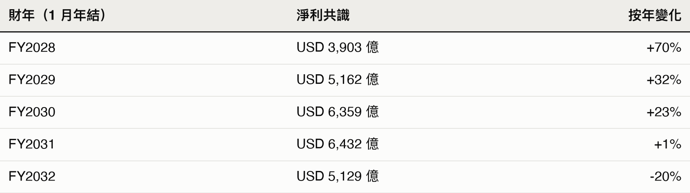
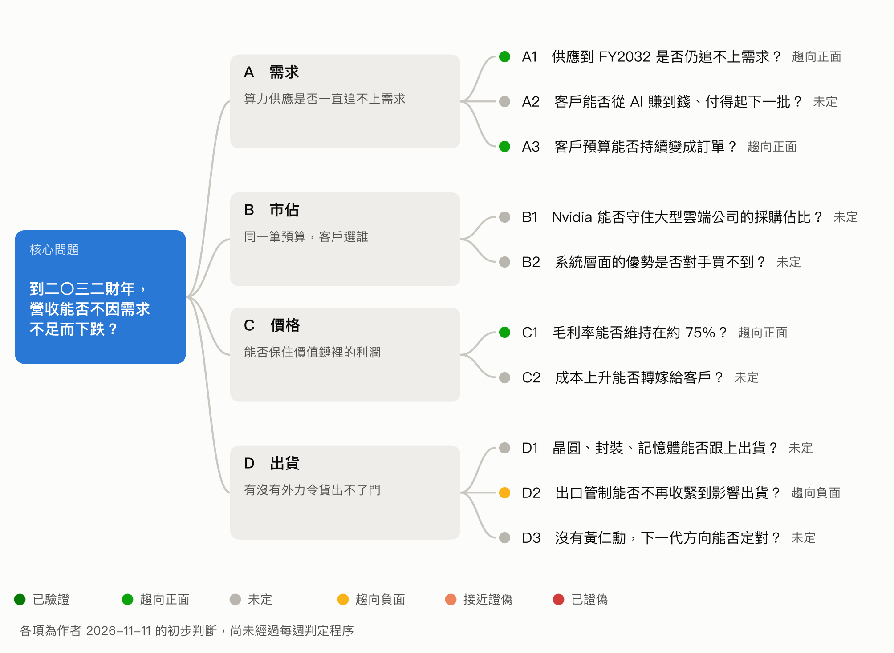
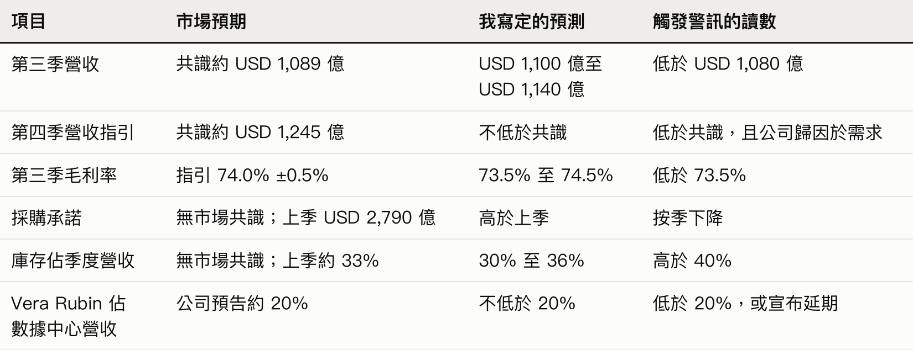

畫樹之前，先拆掉自己的信仰：一次對 Nvidia 長線假說的拷問

一、盈利預期沒動，股價跌了兩成

10 月 29 日，《紐約時報》報導美國情報機關認定，新加坡數據中心公司 Megaspeed 的前高層黃樂（Alice Huang）替北京蒐集情報，且與 Nvidia 執行長黃仁勳關係密切。11 月 8 日，黃仁勳發內部信承認婚外情，董事會隨即啟動外部獨立調查，同時聲明沒有理由相信國安或公司機密受損。

短短八個交易日，Nvidia 收市價從 10 月 29 日的 USD 213.66 跌到 11 月 10 日的 USD 168.80，跌幅達 21%（Yahoo Finance 收市價）。

這段時間裡，有一個數字幾乎沒動過。分析師對下一財年的每股盈利（EPS）共識停在約 USD 15.9，過去一個月沒有下調（Yahoo Finance）。把股價除以這個數字，前瞻本益比（Forward P/E）由約 13.4 倍直接壓到約 10.6 倍。這兩成跌幅不是市場看淡明年的生意，而是市場願意為同一筆盈利付出的倍數變少了。

上一篇文，我用訊號柱處理這場風波的短期傳導。這一篇要處理更難的問題：當估值倍數在收縮，長線看好這家公司的理由，到底經不經得起追問？

二、動筆前，我以為自己想得很清楚

打開白紙準備畫假設樹時，我心裡其實很有底。我把長線看好 Nvidia 的理由濃縮成三句話：

1. Nvidia 的霸主地位仍在，已經超越一位執行長個人所能左右。
2. 它的護城河不只是 CUDA，而是整座 AI 工廠的系統設計。
3. 董事會撤換黃仁勳的機會不高，因為這對美國沒有好處。

看著這三行字，我覺得邏輯嚴密，進可攻退可守。危險恰恰就在這裡。人在市場裡最脆弱的時刻，是手裡握著一套聽起來無懈可擊的說法。越順耳的句子，越像分析，骨子裡越接近信仰。

這次動筆前，我決定借用量化交易公司 Jane Street 公開過的一套蘇格拉底式提問規則，讓 AI 審問我的觀點。規則不留情面：一次只問一條問題；我答得上來，它就立刻站到反方繼續追擊；我邏輯有破綻，它也不糾正，只問一個更窄的問題，逼我自己撞上牆。

沒想到一輪問答下來，那三句話被拆得連渣都不剩。

三、信仰全軍覆沒

正反都算我贏的話，等於什麼都沒說

審問從第一句開始。我說 Nvidia 有「霸主地位」。

對方問：用哪一個數字量度？

我改口說是定價能力，它開多少價，客戶就得付多少。怕力道不夠，我還補了一句聰明話：你看大型雲端公司紛紛自己研發晶片，不是嫌 Nvidia 貴，而是怕命脈被人掐住，這反過來證明 Nvidia 的定價能力強得可怕。

螢幕上沒有跳出長篇大論的反駁，只把我的話排成上下兩行：

- 客戶留下來買單，證明 Nvidia 有定價能力。
- 客戶離開、自己做晶片，也證明 Nvidia 有定價能力。

盯著這兩行字，我背脊發涼。兩個完全相反的世界，都被我拿來當成自己看對的證據。如果一件事無論怎麼發生都能證明我是對的，這句話就沒有半點資訊量，只是用來保護自尊心的廢話。

至於「撤換黃仁勳對美國沒有好處」，它直接戳破：現實裡有四個各自算帳的單位：董事會怕股東集體訴訟，司法部只管有沒有違法，國會看選票，商務部看行政當局的臉色。真正有權決定黃仁勳去留的是董事會，不是華盛頓的整體利益。「對美國沒好處」這句話，擋不住任何一個單一機構為了自保而行動。

要把空話變成能輸的假設，必須綁死數字。我把「定價能力」改寫成毛利率：過去幾季非 GAAP 毛利率都在 75.0% 左右，第三財季指引為 74.0% 上下 0.5 個百分點。證偽條件很簡單：只要毛利率連續兩季下跌，且原因是客戶壓價而非成本上漲，這片樹葉就當場作廢。

揮拳打了稻草人

一棵假設樹的樹頂，必須同時寫下「我相信什麼」和「市場相信什麼」。兩者有落差，才有超額報酬。

我很有把握地敲下樹頂：華爾街共識預期 Nvidia 的盈利在 FY2030 回落約 15%，但我認為不會。這個數字來自我 9 月 24 日存下來的一張共識快照，當時 FY2030 的淨利共識是 USD 4,374 億。

對方問：你今天查過了嗎？

我打開網頁重查 11 月 11 日的最新共識，當場愣住：

（數字取自 Alpha Spread 前瞻本益比表）

短短一個半月，FY2030 的淨利共識已經從 USD 4,374 億調高到 USD 6,359 億，按年大增 23%。賣方分析師早就改了模型，把衰退往後推到了 FY2032（2031 年 2 月至 2032 年 1 月）；Morningstar 九月的報告也把 FY2032 設為營收持平的一年，理由是中期可能出現庫存調整或需求停頓。

我以為自己獨排眾議，站在市場的對立面，結果我揮拳打的是一個早就解散的稻草人。

賣方分析師把盈利增長一路看多到 FY2031，但按 11 月 10 日的市值計算，真金白銀砸出來的股價只相當於 FY2030 共識淨利的約 6.4 倍。

為了對準真正的分歧，我只好把樹頂的目標年份往後推兩年，改鎖定 FY2032。沒想到這一個改動，接著引爆了我沒有想過的邏輯盲點。

時間軸拉長兩年，原本站得住的邏輯塌了

樹頂一推到 FY2032，對方立刻追問黃仁勳離任的風險。

我搬出早就準備好的防線：Nvidia 的產品路線圖已經排到 2028 年，晶片研發是龐大的工程體系，不是一個人的英雄主義，方向既然定了，換人也不會有大分別。

對方的問題像釘子一樣釘進來：你現在賭的是 FY2032 的營收。FY2032 賣的晶片，是 2028 年路線圖之後的那一代；晶片架構必須提早兩到三年敲定，也就是在 2028 年前後拍板。如果黃仁勳在 2027 年離任，你憑什麼確定沒有他，下一代架構還是會定對？

游標在輸入框閃了很久。我最後只打出七個字：老實說，我不清楚。

一家由創辦人帶領超過三十年的公司，能不能把一個人的直覺轉化成制度，外人在事情發生前根本無從得知。Bernstein 的報告指出，黃仁勳目前約有 60 名直屬下屬，公司沒有明確的接班人。這是事實。

至於這個扁平架構失去核心後會繼續運轉還是陷入內耗，誰敢說知道，誰就是在騙人。

順帶一提，審問過程中我還隨口說過「全球用過 AI 的人只有 1% 到 2%」。一查數據又被打臉：Microsoft 估計今年 6 月全球工作年齡人口已有 18.8% 用過生成式 AI。1% 到 2% 比較接近付費用戶的比例。增長空間不在拉攏沒用過的人，而在每個用戶燒多少算力、付多少錢。

四、真正的差異點

把所有自欺欺人的修辭掃開之後，我發現自己真正跟市場對賭的，其實是一句動筆前沒寫在紙上的話：

算力的供應，到 FY2032 仍會追不上需求。

賣方認為 FY2032 前後供應會追上，迎來消化期；我賭不會。因為卡住供應的不只是晶圓與封裝，還有電網接入與土地審批這些砸錢也無法瞬間解決的物理瓶頸；而在需求端，Agentic AI（代理式 AI）將企業工作流程自動化後，算力消耗只會繼續膨脹。

整個長線倉位說穿了，就是賭這場物理稀缺比市場預期的更長命。

認清這一點之後，我把手上的牌重新攤開。除了這一句分歧，剩下的是四項與市場一致的看法（毛利率穩在 75% 左右、雲端資本開支仍在轉為訂單、出口管制壓力上升、黃仁勳離任機率直接採用預測市場定價），以及整整六個我不知道答案的黑盒（客戶燒錢能撐多久、Hyperscale 採購市佔變化、系統優勢對手是否買不到、成本能否轉嫁、上游產能是否跟得上、沒有黃仁勳誰定方向）。

既然底牌只有一張，證偽條件就必須定得乾脆：在 FY2032 或之前任何一個財年，只要 Nvidia 營收按年下跌，同時 GPU 租金走跌、庫存佔營收比例上升，就代表需求不足，直接認錯（最早在 2031 年 2 月公司給出 FY2032 首季指引時見真章；若營收跌但租金升，屬供應卡關或禁令，需提獨立證據，不准事後找藉口）。

看眼前的即時讀數，籌碼暫時贏面較大：2022 年推出的舊款 H100，11 月 9 日每小時租金仍達 USD 3.30，單月漲 24.5%（Ornn 指數）；Nvidia 鎖定產能的採購承諾單季由 USD 1,190 億暴增至 USD 2,790 億；管理層亦明言供應瓶頸至少延續到 FY2028 年底。

五、這棵樹現在的樣子

把盲點與反擊全部釘進結構裡，這棵樹才終於成形。樹頂鎖定 FY2032，底下四根樹枝按營收的四個因素拆開：整體需求有多大、Nvidia 分到多少市佔、每單位能賣多少錢、貨出不出得了門。

六、逐片樹葉：市場怎樣看，我怎樣看

每片樹葉只寫三樣：現時狀態（連同市場與我的看法）、手上的數據、證偽條件。還沒法查的，直接寫「尚未查證」。

樹枝 A：需求（算力供應是否一直追不上需求？）

A1 供應到 FY2032 是否仍追不上需求？

🟢 趨向正面。市場把停頓放在 FY2032；我認為到 FY2032 仍然追不上。

- GPU 租金上升：H100 每小時 USD 3.30，單月升 24.5%；較新的 B200 每小時 USD 9.90，單月升 31.5%（Ornn 指數，2026-11-09）。
- Nvidia 採購承諾單季由 USD 1,190 億增至 USD 2,790 億（Nvidia 10-Q）。
- 管理層稱供應至少到 FY2028 年底仍是瓶頸（8 月 26 日電話會議）。
- 反面：舊晶片是加價轉租，不是退役；OpenAI 管理層在 11 月 3 日選舉後討論是否重設明年的數據中心容量預期，尚未拍板。

證偽條件：GPU 租金持續下跌、庫存佔營收明顯上升、採購承諾縮水，同時營收按年下跌。

A2 客戶能否從 AI 賺到錢、付得起下一批 GPU 升級？

⚪ 未定。市場對資金能否持續有明顯疑慮；我沒有答案。

- OpenAI 第三季營收約 USD 100 億，按季增長近五成；Anthropic 今年首九個月營收 USD 332 億，去年同期僅 USD 25 億。
- 第三季雲端營收：AWS USD 460 億（按年 +39%）、Azure USD 332 億（+48%）、Google Cloud USD 307 億（+103%）。
- 反面：五大買家第三季自由現金流合計首次轉負；Meta 單季資本開支 USD 339 億，高於營運現金流 USD 328 億。

證偽條件：大型雲端公司下調資本開支，並歸因於 AI 投資回報不足或融資成本過高。

A3 客戶預算能否持續變成訂單？

🟢 趨向正面。市場預期大型雲端公司明年資本開支合計超過 USD 1 萬億；我和市場一致。

- Microsoft、Alphabet、Amazon、Meta 第三季資本開支合計約 USD 2,020 億，為去年同期約 USD 973 億的 2.08 倍（Yahoo Finance 現金流量表，倍數屬我的計算）。
- 2026 年指引：Microsoft 由 USD 1,750 億下調至 USD 1,700 億，理由是第三方產能交付延遲，不是砍單；Alphabet 維持 USD 1,950 億至 USD 2,050 億；Meta 將下限由 USD 1,300 億上調至 USD 1,350 億。
- 台積電 10 月營收按年增長 59.7%，高於 9 月的 54.6%。

證偽條件：兩家或以上的大型雲端公司下調下一年度資本開支指引，並歸因於需求放緩或回報不似預期。

樹枝 B：市佔（同一筆預算，客戶選誰？）

B1 Nvidia 能否守住大型雲端公司的採購佔比？

⚪ 未定。我找不到可以直接比較的市場共識，自己也沒有數字。

- 第二財季大型雲端公司（Hyperscale）營收 USD 487.10 億，佔數據中心營收 54.7%。
- 財務長預告第三季增長主力來自其他客群，Hyperscale 要到第四季隨 Vera Rubin 放量才再加速（8 月 26 日電話會議）。所以第三季佔比短暫回落，不算市佔流失。
- 反面：Alphabet 開始把自家 TPU 以整套系統對外出售，約有 100 家客戶，包含 Anthropic 與 Apple；備貨庫存由年初 USD 24 億增至 USD 133 億，主要營收預計在 2027 年反映。

證偽條件：產能不再吃緊時，Hyperscale 營收仍按年下跌；或 Nvidia 失去台積電先進封裝最大客戶的地位。

B2 系統層面的優勢是否對手買不到？

⚪ 未定。我相信，但還沒有查證；市場的看法同樣未定。

- 黃仁勳稱，每吉瓦電力容量對應的 Nvidia 營收機會已由約 USD 180 億升至 USD 400 億以上。
- 這個數字的前提是客戶買齊全套；網路交換器或 CPU 改用第三方產品，金額就會打折。
- 對手整套方案的實測表現：尚未查證。

證偽條件：主要客戶公開表示，以 Nvidia 晶片混搭第三方網路與機櫃，或改用對手整套方案，整體擁有成本（TCO）相同甚至更優。

樹枝 C：價格（Nvidia 能否保住價值鏈裡的利潤？）

C1 毛利率能否維持在約 75%？

🟢 趨向正面。我和市場一致：公司指引第三季為 74.0%，Polymarket 上落在 73% 至 75% 的機率為 88%，惟成交量極低（2026-11-11）。

- 第一與第二財季非 GAAP 毛利率均為 75.0%，去年第二財季為 72.5%；第三財季指引為 74.0%，上下 0.5 個百分點。
- 若第三季落在 74% 左右，就是回落的第一季，屆時要看管理層怎樣解釋。

證偽條件：毛利率連續兩季下跌、累計超過 1 個百分點，且原因是客戶壓價（租金下跌、交貨期縮短或出現折讓），而非良率或成本問題。

C2 成本上升能否轉嫁給客戶？

⚪ 未定。尚未查證，市場與我都沒有可用的數字。

- 目前只確認一項：Nvidia 大增的採購承諾主要用於鎖定記憶體與製造產能（Nvidia 10-Q）。

證偽條件：上游供應商毛利率上升的同一季，Nvidia 毛利率下跌，且管理層歸因於零件成本。

樹枝 D：出貨（有沒有外力令貨出不了門？）

D1 晶圓、封裝、記憶體能否跟上出貨？

⚪ 未定。管理層已經公開說供應是瓶頸，市場早已知道。

- 台積電 10 月營收 TWD 5,868.9 億，按年增長 59.7%。
- 管理層預期 FY2028 營收增長約 70%，並說明這是受供應上限約束後的數字（8 月 26 日電話會議）。
- 先進封裝與記憶體的產能分配：尚未查證。

證偽條件：Nvidia 因關鍵零件短缺而下調季度出貨或營收指引。

D2 出口管制能否不再收緊到影響出貨？

🟡 趨向負面。我和市場一致：短期沒有新禁令，但立法壓力正在上升。

- 第三財季營收指引已經不假設任何來自中國的數據中心運算收入。
- 要求晶片內建位置驗證的《晶片安全法》（S. 1705）已有 21 名兩黨參議員聯署，參議院的國防授權法修正案已把它納入。
- 期中選舉之後，市場擔心 AI 產業將面對更嚴格的審查；Bernstein 形容，這場風波最壞的情況是給了國會議員大量彈藥。

證偽條件：《晶片安全法》通過，或商務部對東南亞買家祭出配額與審批限制，令 Hyperscale 以外的客群營收按季下跌。

D3 沒有黃仁勳，下一代方向能否定對？

⚪ 未定。離任機率我跟市場：Polymarket 顯示今年底前 16.5%、明年 3 月底前 27.5%、明年底前 39%（2026-11-11）。離任之後的影響沒有市場價格可以參考，我也不知道。

- 董事會已於 11 月 8 日啟動外部獨立調查。
- Bernstein 指黃仁勳約有 60 名直屬下屬，公司沒有明確的接班人。

證偽條件：若他離任，新一代產品到 2028 年 GTC 大會仍未發布，或多名核心研發高層離職，同時董事會遲遲未能確立接班人。離任本身不算。

七、把答案寫在考試之前

財報公布之後，股價漲跌都能找到十個完美的事後解釋。要防止自己事後改口，唯一的辦法是在開獎前把標準答案鎖死在檯面上。

Nvidia 將在 11 月 17 日公布第三財季業績。這一季的數字當然答不了 FY2032 的問題，但它是沿途第一個必經的檢查站。今天是 11 月 11 日，我先把這六個讀數的預測與認錯門檻寫死，開獎後絕不回頭塗改：

（共識數字取自 Yahoo Finance，11 月 11 日查詢；公司指引與預告取自 8 月 26 日業績新聞稿與電話會議。預測區間為我根據過往超出指引的幅度及領先指標所訂，屬我的判斷，例如台積電 10 月營收按年增長 59.7%，高於 9 月的 54.6%。）

這張表裡，毛利率一項我和市場沒有分歧，採購承諾與庫存根本沒有賣方共識可比，真正帶有方向性判斷的只有三項。

我之所以把沒有分歧的指標也列進來，是因為畫樹不是為了表演神預測，而是為了替自己的倉位裝上煞車。

八、一棵樹的價值，在於標出哪裡是空的

回頭看動筆前我寫在紙上的那三句話，沒有一句活下來。「霸主地位」被拆成了綁定 75% 毛利率的證偽條件；「系統設計護城河」被貼上了尚未查證的標籤；「不會換掉黃仁勳」則乾脆撤回個人猜測，改看預測市場的定價與接班指標。

三句漂亮話全廢了，卻逼出了一句我當初根本沒意識到的真心話：我賭的是算力稀缺會一路延續到 FY2032，而市場認為不會。

這輪自我審問並沒有讓我對 Nvidia 的未來看得更準。它只幫我做了一件在市場裡更能保命的事：在真金白銀承受波動之前，先弄清楚市場相信什麼、我在哪一點上和它不同，以及手上的假設樹哪幾片樹葉是實心的，哪幾片底下其實什麼都沒有。

後記

Jane Street 的 AI Skill 順手點出的幾個邏輯盲點：

第一，真實世界沒有「無限需求」，只有「付得出錢的需求」。Microsoft、Alphabet、Amazon、Meta 與 Oracle 五大買家第三季的自由現金流合計首次轉負。蓋資料中心的開支已經燒穿本業營運現金流，這場燒本錢的軍備競賽能撐幾年，取決於下游價值鏈能否也同樣繼續賺錢。

第二，電力瓶頸是雙面刃。資料中心拿不到電，買回來的晶片就沒地方插。在缺電的世界裡，Nvidia 的營收上限被鎖死在「新增與替換電力容量 × 每單位電力付給 Nvidia 的金額 × 市佔率」。黃仁勳稱每吉瓦（GW）電力對應的營收機會已由約 USD 180 億升至 USD 400 億以上，但前提是客戶乖乖買齊全套系統，不拆單。

第三，我原本腦補的「汰舊換新潮」根本還沒發生。我曾拿 Microsoft 不續租 Oracle 舊晶片當證據，結果同一批報導顯示，Oracle 到期的舊晶片轉手就加價 20% 轉租，另一家算力商 IREN 的舊 H100 更以原合約兩倍價錢重簽。舊卡沒有退役，只是換了租客。

【免責聲明與風險提示】

本專欄文章由 90sPMInvesting 撰寫，內容僅供學術探討、邏輯框架分享及資訊參考，反映作者於撰文當下基於公開資訊之個人觀點，並不構成任何形式之投資建議、財務諮詢，亦非買賣任何證券、期權或金融衍生品之邀約或招攬。文中的預測為作者個人研究紀錄，可能出錯，亦不代表任何回報承諾。市場情況瞬息萬變，作者不對資訊之完整性或未來表現作任何保證。讀者在作出任何投資決策前，應自行進行獨立研究，並諮詢合格之專業財務顧問。
